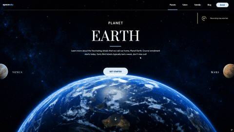

# SpaceEdu — Cinematic Space Hero Section



A full-viewport, cinematic hero section for a space-education brand. Three planets — **Earth**, **Venus**, and **Mars** — take turns as the featured backdrop: a looping 4K-style video fills the whole screen, while the two other planets sit as transparent, glowing cut-outs cropped by the left and right screen edges. Clicking a side planet swaps it into the spotlight in the same frame, with the headline, copy, and labels crossfading instantly — no flash, no reload.

Built as a single self-contained `index.html` — no build step, no framework, no external JS. Every dimension in the layout is derived from one `--u` design-pixel unit, scaled from a fixed 1353×1163 reference composition, so the page stays pixel-faithful from ultra-wide monitors down to narrow phones.

## Features

- **Three-planet switcher** — Earth / Venus / Mars, fully reversible, with instant cut-out swaps (all art is preloaded and toggled via CSS classes, never `src` reassignment)
- **Video backgrounds** — silent, looping 16:9 clips crossfade in ~220ms; lazy-loaded on hover/focus intent, warmed in the background via `requestIdleCallback`
- **One-shot entrance animation** — masked type reveals, drawing hairlines, and staggered rises play once on load, then clean up after themselves (no lingering classes or timers)
- **Fully responsive** — six distinct tiers (desktop, tablet, phone, short-viewport, narrow-phone) driven entirely by the `--u` unit system, including a collapsing glass-panel nav with a burger menu
- **Accessible** — keyboard-operable planet buttons with dynamic `aria-label`s, focus rings, `prefers-reduced-motion` support (animations and hover/press transforms disabled, videos hidden in favor of stills)
- **Zero dependencies** — plain HTML/CSS/JS, Google Fonts only

## Tech Stack

- HTML5 / CSS3 (custom properties, `calc()`-based design system, container-free responsive tiers)
- Vanilla JavaScript (no framework, no build tooling)
- Google Fonts: Prata, Hanken Grotesk, Poppins

## Run Locally

No build step required — just open the file:

```bash
git clone https://github.com/DexAi3000/spaceedu-hero.git
cd spaceedu-hero
```

Then open `index.html` directly in a browser, or serve it locally:

```bash
npx serve .
```
